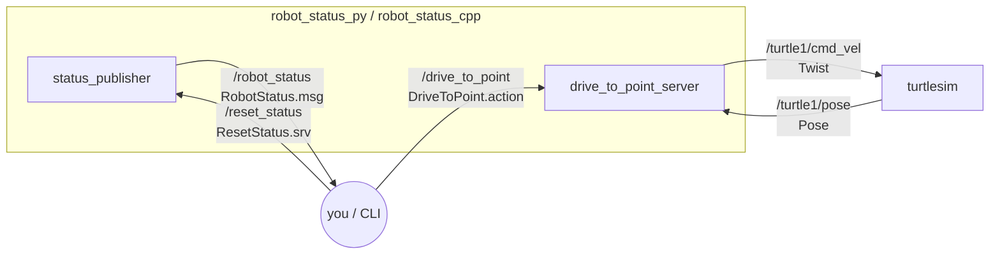

# ROS 2 Robot Status

A small ROS 2 (Jazzy) project that simulates a robot's battery and temperature sensor and drives the
[turtlesim](https://docs.ros.org/en/jazzy/Tutorials/Beginner-CLI-Tools/Introducing-Turtlesim/Introducing-Turtlesim.html)
turtle to a target point. It is built **twice**, once in Python (`rclpy`) and once in C++ (`rclcpp`), with
identical node names, topics and parameters, so either implementation can be swapped in.

It covers the core ROS 2 building blocks:

| Concept | Where |
|---|---|
| Custom message | `RobotStatus.msg`: battery %, voltage, temperature, health level |
| Topic (publisher) | `status_publisher` publishes `/robot_status` on a timer |
| Service | `/reset_status` resets the simulated battery |
| Parameters | `publish_rate_hz` (changeable at runtime), drain rate, thresholds, controller gains |
| Action | `/drive_to_point` drives the turtle to (x, y) with feedback and cancel support |
| Launch file + YAML config | `robot_status.launch.py` starts turtlesim and both nodes |
| Build | `colcon` with `ament_cmake` and `ament_python` packages |

## Architecture



## Packages

```
ros2_robot_status/
├── robot_status_interfaces/   # .msg / .srv / .action definitions (ament_cmake)
├── robot_status_py/           # Python nodes, launch file, params.yaml (ament_python)
└── robot_status_cpp/          # C++ nodes, launch file, params.yaml (ament_cmake)
```

### Interfaces

```
# RobotStatus.msg
uint8 LEVEL_OK=0 / LEVEL_WARN=1 / LEVEL_ERROR=2
std_msgs/Header header
float32 battery_percentage
float32 battery_voltage
float32 temperature_celsius
uint8 level
string message

# ResetStatus.srv
float32 battery_percentage      # (0, 100]
---
bool success
string message

# DriveToPoint.action
float32 x
float32 y
---
bool success
float32 final_x
float32 final_y
string message
---
float32 distance_remaining
```

### Nodes

**`status_publisher`** publishes a simulated `RobotStatus`. The battery drains linearly, and the temperature rises as
the battery empties, plus some noise. The health level becomes `WARN` below `low_battery_threshold` and `ERROR` at ≤ 5 %
battery or > 50 °C.

| Parameter | Default | Notes |
|---|---|---|
| `publish_rate_hz` | `1.0` | Can be changed at runtime; the timer is recreated. Must be > 0. |
| `battery_drain_per_sec` | `0.5` | Percent per second. Must be ≥ 0. |
| `low_battery_threshold` | `20.0` | Percent. |

**`drive_to_point_server`** is an action server that uses a proportional controller on `/turtle1/pose`. It turns toward
the goal and scales forward speed by how well it is facing the goal. It rejects goals outside the turtlesim world
(0–11) and new goals while one is already running, and it supports cancellation.

| Parameter | Default |
|---|---|
| `distance_tolerance` | `0.1` |
| `linear_gain` | `1.5` |
| `angular_gain` | `6.0` |
| `max_linear_speed` | `2.0` |

## Build

Requires ROS 2 Jazzy with `turtlesim` (`sudo apt install ros-jazzy-turtlesim`).

```bash
mkdir -p ~/ros2_ws/src && cd ~/ros2_ws/src
git clone https://github.com/Deepak27-00/ros2_robot_status.git
cd ~/ros2_ws
rosdep install --from-paths src --ignore-src -y
colcon build --packages-up-to robot_status_py robot_status_cpp
source install/setup.bash
```

## Run

Start **one** implementation. Both use the same names, so don't run them at the same time:

```bash
ros2 launch robot_status_py robot_status.launch.py      # Python
ros2 launch robot_status_cpp robot_status.launch.py     # C++

# launch argument example
ros2 launch robot_status_cpp robot_status.launch.py publish_rate_hz:=5.0
```

Then, in another terminal (remember to `source install/setup.bash`):

```bash
# Topic
ros2 topic echo /robot_status
ros2 topic hz /robot_status

# Service
ros2 service call /reset_status robot_status_interfaces/srv/ResetStatus "{battery_percentage: 100.0}"

# Parameters (note: use 5.0 rather than 5, the parameter is a double)
ros2 param list /status_publisher
ros2 param set /status_publisher publish_rate_hz 5.0
ros2 param set /status_publisher publish_rate_hz -1.0   # rejected by validation

# Action (Ctrl+C while it runs to cancel the goal)
ros2 action send_goal --feedback /drive_to_point robot_status_interfaces/action/DriveToPoint "{x: 2.0, y: 9.0}"
```

## Python vs C++: notable differences

| | Python (`rclpy`) | C++ (`rclcpp`) |
|---|---|---|
| Long-running action goal | `MultiThreadedExecutor` + `ReentrantCallbackGroup` so `/turtle1/pose` keeps arriving while `execute` loops | Goal runs in a detached `std::thread`; pose shared via `std::mutex` |
| "One goal at a time" flag | plain `bool` (rclpy callbacks set it under the GIL) | `std::atomic<bool>::exchange` |
| Parameter callbacks | `add_on_set_parameters_callback` / `add_post_set_parameters_callback` | same API; the returned handles must be stored or the callbacks are unregistered |
| Build | `setup.py` entry points + `data_files` for launch/config | `add_executable` + `install(TARGETS / DIRECTORY)` |

## License

Apache-2.0
